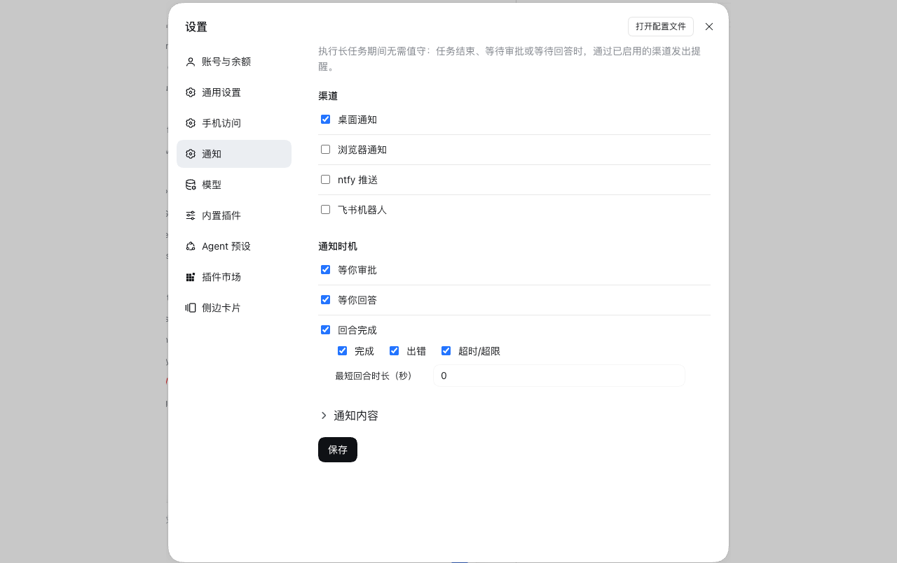

# dsh-notify

English | [中文](README.zh.md)

**Cross-device notifications for DeepSeek Harness.** No attendance is required
while a long task runs: when the turn ends, or waits for your approval or answer, a
notification goes out through the channels you enabled — a desktop toast, a browser tab,
an ntfy push to your phone, a Feishu bot message, in any combination.

- Settings → **Notifications**: pick channels, paste the credentials, press **Send test**
- Four channels: the OS notification centre (macOS / Windows / Linux), your own browser
  tab, ntfy, and a Feishu bot
- Only when you have stepped away: every message waits for an idle window (60 s by
  default) and is dropped if you act inside it — reply, approve, or answer
- Secrets stay in the Host credential seam, never in the configuration file


## Screenshots



## Channels

| Channel | Delivery | Credential |
|---|---|---|
| `local` | Notification Center on macOS, a toast on Windows, `notify-send` on Linux | none |
| `browser` | a system notification from the open GUI tab | browser permission |
| `ntfy` | ntfy publish API | topic + optional token |
| `feishu` | Feishu/Lark custom-bot webhook | webhook prefix + token, optional sign secret |

## Install

### 1. Through the Host's `installBundle` (installs **and** enables)

Ask the agent in a conversation:

> install the plugin `github:miiy/dsh-notify`

or paste the same spec into the install field on **Settings → Plugins**.

Both call the Host's `installBundle`, which installs the package, adds it to
`dsh.profile.bundles`, and hot-applies it — one step.

### 2. From the CLI (`dsh plugin`, installs only)

```sh
dsh plugin --profile <profile> add github:miiy/dsh-notify
```

`dsh plugin` forwards its arguments to pnpm inside the profile directory, so this step
installs the package but does **not** compose it. The row then shows up on
**Settings → Plugins** as installed and switched **off**; turn it on to add it to
`dsh.profile.bundles`. If the switch does not take effect live, restart `dsh web`.

A plain-JavaScript bundle has no build script, so a git install needs no `allowBuilds`
approval.

Accepted spec forms: `github:user/repo`, `git+https://…`, a hosted repository URL, an
absolute local path, or an npm package name.

### 3. From a local checkout (development)

See [MAINTENANCE.md](MAINTENANCE.md) → *Run from a checkout*.

## Configure

Open **Settings → Notifications**.

| Field | Meaning |
|---|---|
| Channels | Desktop, Browser, ntfy, Feishu, any combination. A save is refused while an enabled channel's credential is missing. |
| Feishu bot | The prefix `https://open.feishu.cn/open-apis/bot/v2/hook/` is prefilled and editable; paste only the token that follows it. |
| Browser permission | One click on **Allow notifications**; the page reports the state. |
| Turn completes | Notify on `completed` / `error` / `max-tokens`; `aborted` (your own stop) is never offered. |
| Waiting for approval | Notify when a tool call asks for a decision. |
| Waiting for an answer | Notify when the agent asks you a question. |
| Shortest turn to report | Seconds; `0` reports every turn. |
| Message text | One template per event, prefilled with the default text. First line is the title, the rest is the body; **Restore** puts the default back. |
| Send test | Send one real message through that channel, using the **saved** values. |

Placeholders per event: `{title}` `{outcome}` `{project}` `{duration}` `{preview}`
`{error}` for a finished turn, `{title}` `{project}` `{tool}` `{reason}` for an approval,
`{title}` `{project}` `{question}` `{count}` for a question. An unknown name stays in the
text.

Configuration is stored in `~/.dsh/dsh-notify/config.json` (mode 0600). Credentials go
through the Host credential seam, so the page is told whether a key is set, never its
value.

## Test

```sh
node --check index.js && node --check client.js
node tests/harness.mjs   # host half
node tests/client.mjs    # settings page
```

## Layout

```
index.js          Host half: session events and the question waterfall in, notifications out
client.js         Client half: the settings page and the browser channel
browser.js        The browser channel: one SSE stream per page
config.js         Config file, validation, credential keys and the live settings
rpc.js            The settings page's POST route and envelope
channels.js       local / ntfy / feishu senders
cordis.patch.yml  Bundle patch: one host row
locale/           Plugin card title and description (en, zh)
tests/            Offline checks for both halves
MAINTENANCE.md    What depends on upstream, and what to check after a DSH upgrade
```

## License

MIT
